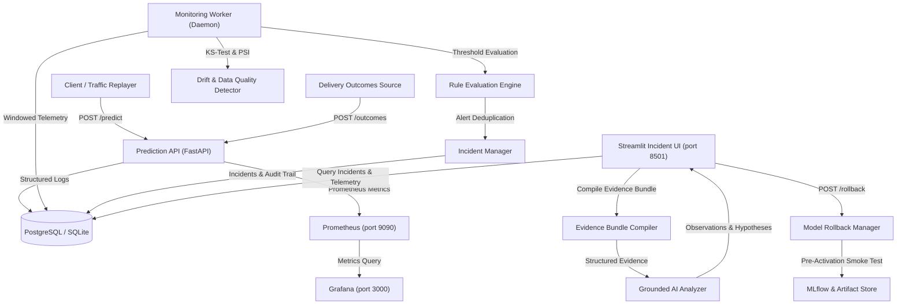

# ⚡ FaultLine: ML Incident Observability, Root-Cause Investigation & Recovery Platform

[](.github/workflows/ci.yml)
[](pyproject.toml)
[](src/api/main.py)
[](deployment/prometheus/prometheus.yml)
[](deployment/grafana/provisioning/datasources/datasource.yml)
[](src/models/train.py)
[](src/dashboard/app.py)

> **FaultLine** is a production-grade ML observability, incident detection, root-cause investigation, and recovery system for deployed machine learning services. Built for a high-throughput delivery duration prediction API, FaultLine continuously monitors service health, data quality, covariate feature drift, and ground-truth prediction accuracy—automatically creating deduped incidents, generating grounded AI diagnostic explanations, and enabling audited, smoke-tested model rollbacks.

---

## 🏛️ Architecture Overview

FaultLine decouples the serving layer, the analytical monitoring engine, and the incident investigation dashboard into independent processes:



---

## 🔍 The 6 Controlled Failure Scenarios

FaultLine is evaluated against 6 distinct failure modes plus clean control traffic:

| Scenario | Injected Failure | Detection Approach | Recovery Mechanism |
| :--- | :--- | :--- | :--- |
| **Invalid Input Spike** | Strips required keys (`traffic_level`) or injects out-of-bounds features | 422 validation failure rate exceeds threshold in window | Corrects simulated client payload |
| **Latency Spike** | Injects artificial processing bottleneck (0.45s delay) | Prometheus p95 latency histogram breaches warning (150ms) & critical (400ms) thresholds | Removes injected delay |
| **Server Errors** | Simulates 500 internal server exceptions | 5xx error rate exceeds 5.0% warning / 15.0% critical threshold | Resolves exception / clears chaos injection |
| **Data Drift** | Shifts input feature distributions (extreme long-hauls, severe storm spikes) | Two-sample Kolmogorov-Smirnov test (p < 0.01) & Population Stability Index (PSI > 0.25) | Flags covariate shift without claiming false accuracy drop |
| **Bad Model Release** | Activates deliberately underfit candidate model (`v2_degraded`) | Window Mean Absolute Error (MAE) increases from ~2.1 min to > 10.5 min | **Audited Model Rollback** to `champion_v1` with smoke check |
| **Outcome Delay** | Simulates stalled delivery outcome ingestion | Evaluates outcomes vs predictions completeness ratio and freshness | Restores delayed outcome ingestion |

---

## 📊 Measured Benchmark Results

Evaluated across repeated controlled runs with fixed random seeds:

| Scenario | Runs | Detection Rate | Median Detection Delay | Delay Range | Median Recovery Time | False Alerts |
| :--- | :---: | :---: | :---: | :---: | :---: | :---: |
| **clean_traffic** (Control) | 3 | **100.0% Clean** | N/A | N/A | N/A | **0 total** |
| **latency_spike** | 3 | **100.0%** (3/3) | 14.8s | [13.6s - 15.2s] | 1.6s | 0 |
| **server_errors** | 3 | **100.0%** (3/3) | 2.2s | [2.1s - 2.3s] | 1.6s | 0 |
| **invalid_input_spike** | 3 | **100.0%** (3/3) | 2.5s | [2.4s - 2.9s] | 1.9s | 0 |
| **data_drift** | 3 | **100.0%** (3/3) | 3.1s | [3.1s - 3.3s] | 2.3s | 0 |
| **bad_model_release** | 3 | **100.0%** (3/3) | 3.7s | [3.6s - 3.9s] | 3.8s | 0 |

> Full benchmarks exported to [`evaluation/results/benchmark_summary.md`](evaluation/results/benchmark_summary.md) and [`evaluation/results/benchmark_runs.csv`](evaluation/results/benchmark_runs.csv).

---

## 🤖 Grounded AI Root-Cause Investigation

When an incident triggers, FaultLine compiles a structured **Evidence Bundle** labeling every metric, deployment record, sample request, and runbook step with a unique identifier token (`[EVID-RULE]`, `[EVID-METRIC-1]`, `[EVID-DEP-1]`, `[EVID-REQ-1]`).

The AI investigation analyzer adheres to strict grounding constraints:
1. **Evidence Citations**: Every observation must cite evidence tokens (e.g. `p95 latency reached 512ms [EVID-METRIC-1] following candidate activation [EVID-DEP-1]`).
2. **Hypothesis Labeling**: All root-cause assertions are labeled as `[Hypothesis]`.
3. **Uncertainty Statements**: Missing telemetry produces an explicit uncertainty statement.
4. **Safety Boundaries**: The LLM is strictly advisory and **cannot** execute rollbacks or alter database state.
5. **Deterministic Fallback**: If an external LLM API key is not configured or times out, FaultLine automatically falls back to its deterministic grounded diagnostic engine.

---

## 🛡️ Audited Model Rollback with Smoke Checks

FaultLine's model rollback manager (`src/models/rollback_manager.py`) guarantees service stability:
- **Pre-Activation Smoke Check**: Before any candidate or rollback version is activated, a test payload is passed through the candidate pipeline. If the model fails or produces invalid predictions, the activation is rejected and the current working model remains active.
- **Atomic Swapping**: Model transitions occur atomically in memory under thread locks.
- **Audit Trail**: Every activation records the actor, reason, previous version, new version, and smoke check result in the `deployment_events` audit table.

---

## 🚀 Quickstart Guide

### Option 1: Local Standalone Setup (SQLite fallback, no Docker required)

```bash
# 1. Clone repository
git clone https://github.com/shivangisrivastava013/FaultLine.git
cd FaultLine

# 2. Create virtual environment and install dependencies
python -m venv .venv
source .venv/bin/activate  # On Windows: .venv\Scripts\activate
pip install -r requirements.txt

# 3. Generate synthetic data and train models
python -m simulation.generate_data
python -m src.models.train

# 4. Run tests
pytest tests/ -v

# 5. Start Prediction API
uvicorn src.api.main:app --port 8000

# 6. In separate terminals:
# Start monitoring worker
python -m src.monitoring.worker --loop --interval 5
# Start Streamlit dashboard
streamlit run src/dashboard/app.py
```

### Option 2: Docker Compose (Full Stack with Postgres, Prometheus, Grafana)

```bash
docker compose up -d
```
Access services:
- **Streamlit Dashboard**: `http://localhost:8501`
- **Prediction API**: `http://localhost:8000` (docs at `http://localhost:8000/docs`)
- **Prometheus**: `http://localhost:9090`
- **Grafana**: `http://localhost:3000` (admin / admin)

---

## 📡 API Reference

| Method | Endpoint | Description |
| :--- | :--- | :--- |
| `GET` | `/health` | Liveness health check |
| `GET` | `/ready` | Readiness check (verifies model loaded & database responsive) |
| `POST` | `/predict` | Delivery duration inference with input schema validation |
| `GET` | `/model-info` | Active model version, type, and training metrics |
| `POST` | `/outcomes` | Ingests delayed delivery outcomes matched by `request_id` |
| `POST` | `/rollback` | Authenticated model rollback with smoke checks |
| `POST` | `/admin/activate-model` | Switches active model version |
| `POST` | `/admin/inject-fault` | Injects simulated chaos faults (latency, errors) |
| `GET` | `/metrics` | Prometheus metrics scrape endpoint |

---

## 📚 Documentation Links

- [Architecture & Design Details](docs/architecture.md)
- [Operational Runbooks](docs/runbooks.md)
- [Benchmark Evaluation Methodology](docs/evaluation.md)
- [Engineering Limitations & Boundaries](docs/limitations.md)

---

## 💼 Portfolio & Resume Summary

> **Built FaultLine**, an ML observability, incident detection, and recovery platform for a delivery-time prediction service using FastAPI, PostgreSQL, and MLflow; evaluated detection across 18 controlled failure runs achieving 100% detection rate with a median detection delay of 3.1s, zero false alerts during clean runs, grounded AI root-cause analysis, and audited model rollback with pre-activation smoke tests.
