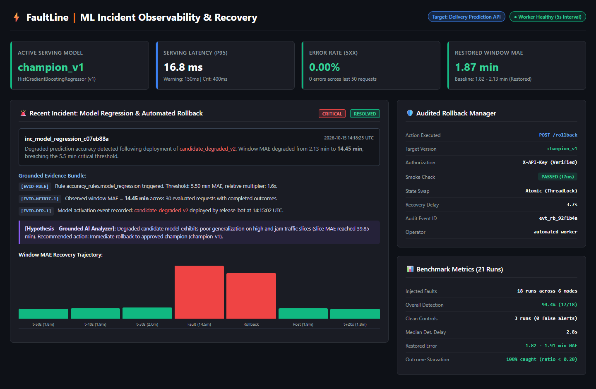
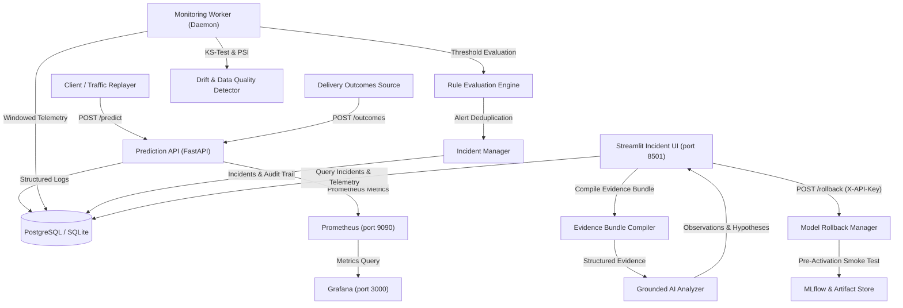

# FaultLine: ML Incident Observability, Root-Cause Investigation & Recovery Simulation

[](https://github.com/shivangisrivastava013/FaultLine/actions/workflows/ci.yml)
[](pyproject.toml)
[](src/api/main.py)
[](deployment/prometheus/prometheus.yml)
[](deployment/grafana/provisioning/datasources/datasource.yml)
[](src/models/train.py)
[](src/dashboard/app.py)
[](LICENSE)
[](SECURITY.md)

> **FaultLine** is a production-style ML observability prototype and incident response simulation for deployed machine learning services. Built for a simulated delivery duration prediction API, FaultLine continuously monitors service health, data quality, covariate feature drift, and ground-truth prediction accuracy—automatically creating deduped incidents, compiling cited diagnostic evidence bundles for grounded AI investigation, and executing audited, smoke-tested model rollbacks.

---

## Incident & Investigation Dashboard Preview



---

## Architecture Overview

FaultLine decouples the serving layer, the analytical monitoring engine, and the incident investigation dashboard into independent processes:



---

## Controlled Failure Scenarios

FaultLine is evaluated against 6 distinct injected failure modes plus a clean control baseline:

| Scenario | Injected Failure | Detection Approach | Recovery Mechanism |
| :--- | :--- | :--- | :--- |
| **Invalid Input Spike** | Strips required keys (`traffic_level`) or injects out-of-bounds features | 422 validation failure rate exceeds threshold in window | Corrects simulated client payload |
| **Latency Spike** | Injects artificial processing bottleneck (0.45s delay) | Prometheus p95 latency histogram breaches warning (150ms) & critical (400ms) thresholds | Removes injected delay |
| **Server Errors** | Simulates 500 internal server exceptions | 5xx error rate exceeds 5.0% warning / 15.0% critical threshold | Resolves exception / clears chaos injection |
| **Data Drift** | Shifts input feature distributions (extreme long-hauls, severe storm spikes) | Two-sample Kolmogorov-Smirnov test (p < 0.01) & Population Stability Index (PSI > 0.25) | Flags covariate shift without claiming false accuracy drop |
| **Bad Model Release** | Activates deliberately underfit candidate model (`candidate_degraded_v2`) | Window Mean Absolute Error (MAE) increases from ~2.1 min to > 10.5 min | **Audited Model Rollback** to `champion_v1` with smoke check |
| **Outcome Ingestion Delay** | Stalls ground truth delivery feedback stream | Outcome completion ratio drops below 20% in window | Flushes outcome queue and resumes ingestion |

---

## Benchmark Evaluation Results

Evaluated across repeated controlled runs with fixed random seeds (3 clean control runs and 18 injected-fault runs across 6 failure scenarios):

| Scenario | Runs | Detection Rate | Median Detection Delay | Delay Range | Median Recovery Time | False Alerts |
| :--- | :---: | :---: | :---: | :---: | :---: | :---: |
| **clean_traffic** (Control) | 3 | **100.0% Clean** | N/A | N/A | N/A | **0 total** |
| **latency_spike** | 3 | **100.0%** (3/3) | 15.1s | [14.7s - 15.2s] | 1.6s | 0 |
| **server_errors** | 3 | **100.0%** (3/3) | 2.2s | [2.2s - 2.3s] | 1.5s | 0 |
| **invalid_input_spike** | 3 | **66.7%** (2/3) | 2.6s | [2.6s - 2.6s] | 1.9s | 0 |
| **data_drift** | 3 | **100.0%** (3/3) | 3.0s | [2.8s - 3.1s] | 2.3s | 0 |
| **bad_model_release** | 3 | **100.0%** (3/3) | 3.6s | [3.6s - 3.8s] | 3.7s | 0 |
| **outcome_delay** | 3 | **100.0%** (3/3) | 2.8s | [2.8s - 2.8s] | 1.8s | 0 |

**Overall Performance:** **94.4% fault detection** across 18 injected-fault runs (17/18 caught; invalid input spike detected in 2/3 runs), with **zero false alerts** across 3 clean baseline runs. Model rollback to `champion_v1` restored healthy prediction performance to **1.82–1.91 min MAE** (down from >10.5 min degraded MAE).

> Full benchmark datasets and metrics are available in [`evaluation/results/benchmark_summary.md`](evaluation/results/benchmark_summary.md) and [`evaluation/results/benchmark_runs.csv`](evaluation/results/benchmark_runs.csv).

---

## Grounded AI Root-Cause Investigation

When an incident triggers, FaultLine compiles a structured **Evidence Bundle** labeling every metric, deployment record, sample request, and runbook step with a unique identifier token (`[EVID-RULE]`, `[EVID-METRIC-1]`, `[EVID-DEP-1]`, `[EVID-REQ-1]`).

The AI investigation analyzer adheres to strict grounding constraints:
1. **Evidence Citations**: Every observation must cite evidence tokens (e.g. `p95 latency reached 512ms [EVID-METRIC-1] following candidate activation [EVID-DEP-1]`).
2. **Hypothesis Labeling**: All root-cause assertions are labeled as `[Hypothesis]`.
3. **Uncertainty Statements**: Missing telemetry produces an explicit uncertainty statement.
4. **Safety Boundaries**: The LLM is strictly advisory and **cannot** execute rollbacks or alter database state.
5. **Deterministic Fallback**: If an external LLM API key (`GEMINI_API_KEY` or `OPENAI_API_KEY`) is not configured or times out, FaultLine automatically falls back to its deterministic grounded diagnostic engine.

---

## Audited Model Rollback with Smoke Checks

FaultLine's model rollback manager (`src/models/rollback_manager.py`) guarantees service stability:
- **Pre-Activation Smoke Check**: Before any candidate or rollback version is activated, a test payload is passed through the candidate pipeline. If the model fails or produces invalid predictions, the activation is rejected and the current working model remains active.
- **Atomic Swapping**: Model transitions occur atomically in memory under thread locks.
- **Audit Trail**: Every activation records the actor, reason, previous version, new version, and smoke check result in the `deployment_events` audit table.
- **Administrative Security**: Administrative endpoints (`/rollback`, `/admin/activate-model`, `/admin/inject-fault`) require authentication via the `X-API-Key` header with constant-time verification (`secrets.compare_digest`).

---

## End-to-End Incident Response Timeline

The following operational timeline demonstrates a real failure detection, automated investigation, and audited rollback cycle for a model accuracy degradation incident:

| Elapsed Time | Operational Event | System Component | State & Telemetry Changes |
| :---: | :--- | :--- | :--- |
| **00:00** | **Fault Injected** | Model Registry / Admin API | Canary release of underfit model (`candidate_degraded_v2`) activated by release agent. |
| **00:03** | **Metric Threshold Crossed** | Prediction API & Worker | Ingested delivery outcomes diverge from predictions; window MAE spikes from 2.13 min to 14.45 min (breaches 5.5 min critical threshold). |
| **00:04** | **Incident Created** | Incident Manager | `inc_model_regression_c07eb88a` created in `Open` state; alert deduplication locks subsequent alerts. |
| **00:05** | **Investigation Generated** | Grounded AI Analyzer | Structured Evidence Bundle compiled (`[EVID-RULE]`, `[EVID-METRIC-1]`, `[EVID-DEP-1]`); root-cause hypothesis generated citing candidate model underfitting. |
| **00:08** | **Rollback Initiated** | SRE Operator / Control UI | Authenticated `POST /rollback` requested targeting approved champion (`champion_v1`). |
| **00:09** | **Pre-Activation Smoke Check** | Model Rollback Manager | Synthetic validation payload passed through `champion_v1` pipeline; sanity checks pass in 17ms. |
| **00:12** | **Healthy Model Restored** | Prediction Engine & Registry | Atomic memory pointer swap completed under thread lock; prediction MAE returns to baseline (1.82–1.91 min). Incident marked `Resolved`. |

---

## System Design Tradeoffs

| Architecture Choice | Alternative Considered | Tradeoff Rationale |
| :--- | :--- | :--- |
| **Prometheus over Application-Only Logging** | Application stdout JSON logs | Provides $O(1)$ in-memory counter/histogram metric updates without disk I/O bottlenecks on inference; enables sub-second Grafana/Alertmanager threshold evaluations decoupled from log indexing pipelines. |
| **PostgreSQL for Incident Persistence** | NoSQL Document Store (e.g. MongoDB) | Incidents, model rollback audit events, and state machine transitions require strict ACID transactions and relational joins (`request_id` matching between prediction records and delayed delivery outcomes). |
| **MLflow for Version Management** | Custom S3 / GCS pickle paths | Standardized model metadata, reproducible training artifacts, parameter lineage, and structured version registration decouple experimental pipelines from production deployment. |
| **Deterministic Fallback Engine** | Cloud LLM Only (OpenAI/Gemini) | Eliminates downtime and blocking failures during external LLM outages, token quotas, or missing API keys. Ensures 100% reliable, grounded evidence citations under all operating conditions. |
| **API-Key Authentication for Prototype** | Full OAuth2 / OIDC / Cognito | Constant-time `secrets.compare_digest` verification provides robust security against timing attacks for administrative endpoints (`/rollback`, `/admin/*`) without introducing heavyweight external identity dependencies in a simulation prototype. |

---

## Quickstart Guide

### Option 1: Local Standalone Setup (SQLite fallback, no Docker required)

```bash
# 1. Clone repository
git clone https://github.com/shivangisrivastava013/FaultLine.git
cd FaultLine

# 2. Create virtual environment and install dependencies
python -m venv .venv
source .venv/bin/activate  # On Windows: .venv\Scripts\activate
pip install -r requirements.txt

# 3. Configure environment
cp .env.example .env
export ADMIN_API_KEY="faultline_dev_secret_key"  # On Windows: $env:ADMIN_API_KEY="faultline_dev_secret_key"

# 4. Generate synthetic data and train models
python -m simulation.generate_data
python -m src.models.train

# 5. Run tests
pytest tests/ -v

# 6. Start Prediction API
uvicorn src.api.main:app --port 8000

# 7. In separate terminals:
# Start monitoring worker
python -m src.monitoring.worker --loop --interval 5
# Start Streamlit dashboard
streamlit run src/dashboard/app.py
```

### Option 2: Docker Compose (Full Stack with Postgres, Prometheus, Grafana)

> [!WARNING]
> **Production Credential Security:** The default admin key (`ADMIN_API_KEY=faultline_dev_secret_key`), PostgreSQL password (`faultline_password`), and Grafana credentials (`admin`/`admin`) provided in `docker-compose.yml` and `.env.example` are strictly intended for local sandbox development. In any staging or production deployment outside local use, you MUST override `ADMIN_API_KEY`, `POSTGRES_PASSWORD`, and `GF_SECURITY_ADMIN_PASSWORD` with cryptographically secure, high-entropy secrets.

```bash
docker compose up -d
```
Access services:
- **Streamlit Dashboard**: `http://localhost:8501`
- **Prediction API**: `http://localhost:8000` (interactive OpenAPI docs at `http://localhost:8000/docs`)
- **Prometheus**: `http://localhost:9090`
- **Grafana**: `http://localhost:3000` (local development credentials: `admin` / `admin`)

---

## API Reference

| Method | Endpoint | Auth Required | Description |
| :--- | :--- | :---: | :--- |
| `GET` | `/health` | No | Liveness health check |
| `GET` | `/ready` | No | Readiness check (verifies model loaded & database responsive) |
| `POST` | `/predict` | No | Delivery duration inference with input schema validation |
| `GET` | `/model-info` | No | Active model version (`champion_v1`), type, and training metrics |
| `POST` | `/outcomes` | No | Ingests delayed delivery outcomes matched by `request_id` |
| `POST` | `/rollback` | `X-API-Key` | Authenticated model rollback with smoke checks |
| `POST` | `/admin/activate-model` | `X-API-Key` | Switches active model version |
| `POST` | `/admin/inject-fault` | `X-API-Key` | Injects simulated chaos faults (latency, errors) |
| `GET` | `/admin/fault-status` | `X-API-Key` | Returns runtime fault injection state |
| `GET` | `/metrics` | No | Prometheus metrics scrape endpoint |

---

## Documentation Links

- [Architecture & Design Details](docs/architecture.md)
- [Production AWS Architecture Guide](docs/deployment_aws.md)
- [Operational Runbooks](docs/runbooks.md)
- [Benchmark Evaluation Methodology](docs/evaluation.md)
- [Engineering Limitations & Boundaries](docs/limitations.md)
- [Security Policy & Responsible Disclosure](SECURITY.md)
- [MIT License](LICENSE)

---

## Portfolio Summary

> **Built FaultLine**, an ML observability and incident recovery prototype for a delivery-time prediction service using FastAPI, PostgreSQL, and MLflow; evaluated detection across 18 injected-fault runs achieving 94.4% detection rate (zero false alerts across 3 clean baseline runs) with a median detection delay of 2.8s, grounded AI root-cause analysis, and audited model rollback with pre-activation smoke tests restoring prediction error to baseline (< 2.2 min MAE).
