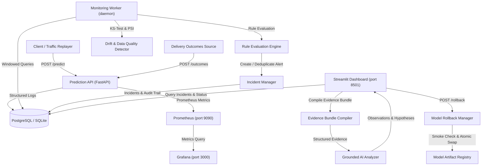

# FaultLine Architecture & Systems Design

FaultLine is an ML incident observability, automated detection, root-cause investigation, and recovery system for deployed machine learning services. It monitors a delivery-time prediction API across operational health, incoming feature quality, distribution drift, and ground-truth model accuracy.

---

## 1. High-Level System Architecture

---

## 2. Component Breakdown

### 2.1 Prediction API (`src/api/`)
- Built with **FastAPI** and **Pydantic v2**.
- Exposes:
  - `GET /health`: Liveness probe.
  - `GET /ready`: Readiness probe verifying active model is in memory and database is reachable.
  - `POST /predict`: Performs input validation against physical boundaries, generates inference using the active pipeline, records structured telemetry in the database, and exposes Prometheus metric observations.
  - `GET /model-info`: Returns active model metadata, feature lists, and validation metrics.
  - `POST /outcomes`: Ingests delayed delivery durations matched to predictions via `request_id`.
  - `POST /rollback`: Authenticated model rollback with mandatory pre-activation smoke tests (requires `X-API-Key`).
  - `POST /admin/activate-model`: Model version promotion endpoint (requires `X-API-Key`).
  - `POST /admin/inject-fault`: Chaos injection controls for controlled benchmarking and demonstrations (requires `X-API-Key`).
  - `GET /metrics`: Prometheus metric scrape endpoint.

### 2.2 Model Pipeline & Registry (`src/models/`)
- Encapsulates complete preprocessing (`StandardScaler` + `OneHotEncoder`) and model estimators inside a single unified scikit-learn pipeline bundle.
- Models tracked:
  - **Champion Model (`champion_v1`)**: `HistGradientBoostingRegressor`, optimized over 15,000 synthetic records with realistic physics (MAE: 2.13 min, R²: 0.98).
  - **Baseline Linear Model (`v0_linear`)**: `Ridge` regressor baseline (MAE: 4.63 min).
  - **Candidate Degraded Model (`v2_degraded`)**: Deliberately underfit model trained on biased sample slices to trigger performance regressions (MAE: 11.57 min).
- Experiment tracking integrated with modern SQLite-backed **MLflow** registry.

### 2.3 Rollback Manager (`src/models/rollback_manager.py`)
- Manages atomic swapping of the active model in memory under a thread lock.
- **Mandatory Smoke Check**: Before any candidate or rollback version is activated, a synthetic test payload is passed through the candidate pipeline. If the model fails or produces invalid predictions, the activation is aborted, leaving the current working model untouched.
- Every activation logs an immutable audit event in `deployment_events`.

### 2.4 Monitoring Worker (`src/monitoring/worker.py`)
- Independent process running in a background loop or scheduled cron.
- Evaluates rolling windows across:
  1. **Operational Metrics**: Total volume, p50/p95 request latencies, 5xx server error rates, 422 validation failure rates.
  2. **Data Quality & Drift**: Missing value ratios, out-of-range bounds, unrecognized categorical values, two-sample Kolmogorov-Smirnov (KS) tests on continuous features (`distance_km`, `restaurant_load`), and Population Stability Index (PSI) on categorical features (`traffic_level`, `weather`).
  3. **Accuracy & Outcomes**: Mean Absolute Error (MAE) computed over completed trips joined by `request_id`, plus segment MAE breakdowns across traffic tiers.

### 2.5 Incident Lifecycle & State Machine (`src/incidents/`)
- State Machine: `Open` -> `Acknowledged` -> `Resolved`.
- **Deduplication Engine**: When a rule breaches threshold, the system checks for an existing active (`Open` or `Acknowledged`) incident for that `(incident_type, model_version)`. If found, `last_observed_at` and evidence history are updated in-place rather than spamming duplicate alerts.
- Full audit history logged in `incident_actions`.

### 2.6 Grounded AI Investigation Analyzer (`src/investigation/`)
- Compiles an `EvidenceBundle` where every metric, rule threshold, recent deployment, sample request, and runbook step is labeled with an explicit token (`[EVID-RULE]`, `[EVID-METRIC-1]`, `[EVID-DEP-1]`, `[EVID-REQ-1]`).
- The analyzer returns a structured JSON investigation report where:
  - Every observation cites evidence tokens.
  - Causes are explicitly tagged as `[Hypothesis]`.
  - Missing evidence produces an uncertainty statement.
  - The AI has read-only diagnostic capability and **cannot** execute rollbacks.
  - Deterministic fallback ensures full functionality even without external LLM API keys.

---

## 3. Database Schema

- `prediction_requests`: `request_id`, `timestamp`, `model_version`, input features, `predicted_minutes`, `latency_ms`, `status_code`, `error_message`.
- `outcomes`: `request_id`, `actual_delivery_minutes`, `created_at`.
- `monitoring_windows`: `window_id`, `start_time`, `end_time`, `sample_count`, `error_rate`, `val_failure_rate`, `p95_latency_ms`, `mae`, `status`.
- `incidents`: `incident_id`, `incident_type`, `severity`, `status`, `first_detected_at`, `last_observed_at`, `model_version`, `evidence` (JSON), `recommended_action`, `resolved_at`.
- `deployment_events`: `event_id`, `timestamp`, `activated_version`, `previous_version`, `actor`, `reason`, `smoke_test_passed`.
- `incident_actions`: `action_id`, `incident_id`, `timestamp`, `actor`, `action_type`, `details` (JSON).

---

## 4. System Design Tradeoffs

| Architecture Choice | Alternative Considered | Tradeoff Rationale |
| :--- | :--- | :--- |
| **Prometheus over Application-Only Logging** | Application stdout JSON logs | Provides $O(1)$ in-memory counter/histogram metric updates without disk I/O bottlenecks on inference; enables sub-second Grafana/Alertmanager threshold evaluations decoupled from log indexing pipelines. |
| **PostgreSQL for Incident Persistence** | NoSQL Document Store (e.g. MongoDB) | Incidents, model rollback audit events, and state machine transitions require strict ACID transactions and relational joins (`request_id` matching between prediction records and delayed delivery outcomes). |
| **MLflow for Version Management** | Custom S3 / GCS pickle paths | Standardized model metadata, reproducible training artifacts, parameter lineage, and structured version registration decouple experimental pipelines from production deployment. |
| **Deterministic Fallback Engine** | Cloud LLM Only (OpenAI/Gemini) | Eliminates downtime and blocking failures during external LLM outages, token quotas, or missing API keys. Ensures 100% reliable, grounded evidence citations under all operating conditions. |
| **API-Key Authentication for Prototype** | Full OAuth2 / OIDC / Cognito | Constant-time `secrets.compare_digest` verification provides robust security against timing attacks for administrative endpoints (`/rollback`, `/admin/*`) without introducing heavyweight external identity dependencies in a simulation prototype. |

---

## 5. End-to-End Incident Timeline Example

The following operational timeline demonstrates a typical failure detection, automated investigation, and audited rollback cycle for a model accuracy degradation incident:

| Elapsed Time | Operational Event | System Component | State & Telemetry Changes |
| :---: | :--- | :--- | :--- |
| **00:00** | **Fault Injected** | Model Registry / Admin API | Canary release of underfit model (`candidate_degraded_v2`) activated by release agent. |
| **00:03** | **Metric Threshold Crossed** | Prediction API & Worker | Ingested delivery outcomes diverge from predictions; window MAE spikes from 2.13 min to 14.45 min (breaches 5.5 min critical threshold). |
| **00:04** | **Incident Created** | Incident Manager | `inc_model_regression_c07eb88a` created in `Open` state; alert deduplication locks subsequent alerts. |
| **00:05** | **Investigation Generated** | Grounded AI Analyzer | Structured Evidence Bundle compiled (`[EVID-RULE]`, `[EVID-METRIC-1]`, `[EVID-DEP-1]`); root-cause hypothesis generated citing candidate model underfitting. |
| **00:08** | **Rollback Initiated** | SRE Operator / Control UI | Authenticated `POST /rollback` requested targeting approved champion (`champion_v1`). |
| **00:09** | **Pre-Activation Smoke Check** | Model Rollback Manager | Synthetic validation payload passed through `champion_v1` pipeline; sanity checks pass in 17ms. |
| **00:12** | **Healthy Model Restored** | Prediction Engine & Registry | Atomic memory pointer swap completed under thread lock; prediction MAE returns to baseline (1.82–1.91 min). Incident marked `Resolved`. |
