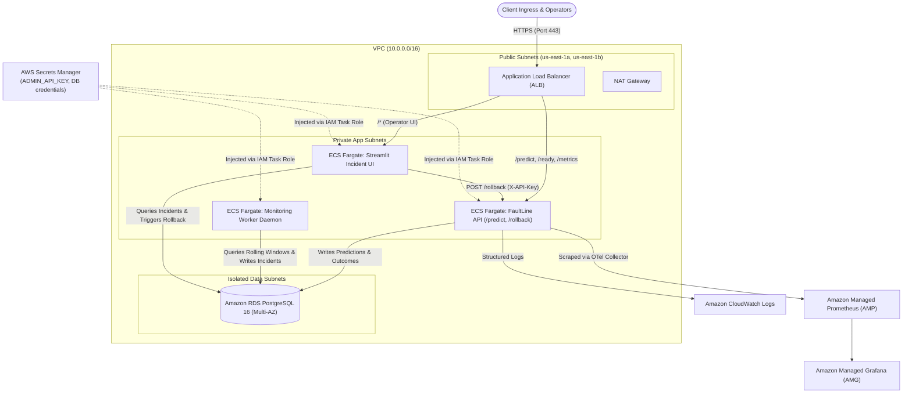

# FaultLine: Production AWS Architecture & Deployment Guide

This document outlines the enterprise cloud architecture for deploying FaultLine into Amazon Web Services (AWS) using managed container, database, observability, and secret management primitives.

---

## 1. Cloud Architecture Overview

FaultLine decouples the high-throughput inference serving layer, the asynchronous window evaluation worker, and the interactive incident dashboard into dedicated Amazon ECS Fargate services isolated within private subnets.



---

## 2. Infrastructure Components

### 2.1 Compute (Amazon ECS on AWS Fargate)
- **Fargate Task Definitions**: Serverless execution eliminates node maintenance and container host patching.
  - `faultline-api`: 1.0 vCPU / 2 GB RAM; autoscales based on target tracking (CPU > 70% or Target Response Time < 45ms).
  - `faultline-worker`: 0.5 vCPU / 1 GB RAM (runs as an independent singleton ECS service with restart on failure).
  - `faultline-dashboard`: 0.5 vCPU / 1 GB RAM (isolated internal administrative endpoint).
- **Graceful Shutdown**: Tasks handle `SIGTERM` to flush active telemetry windows before termination.

### 2.2 Storage & Persistence (Amazon RDS PostgreSQL)
- **Instance Class**: `db.m6g.large` (Graviton3-based) running PostgreSQL 16.
- **Availability**: Multi-AZ deployment with synchronous standby replication.
- **Security**:
  - Encrypted at rest via AWS KMS customer-managed key.
  - Inaccessible from the public internet (isolated database subnet group).
  - Enforced SSL connections (`sslmode=require`).

### 2.3 Secret Management (AWS Secrets Manager)
- Secrets managed:
  - `faultline/admin-api-key`: High-entropy 256-bit token for `/rollback` and `/admin/*`.
  - `faultline/database`: Master username, password, host, and port.
  - `faultline/ai-credentials`: `GEMINI_API_KEY` / `OPENAI_API_KEY`.
- Injected natively into ECS containers at launch time using IAM execution roles without writing secrets to disk or container images.

### 2.4 Telemetry & Observability
- **Prometheus Metrics**: Scraped via AWS Distro for OpenTelemetry (ADOT) sidecar and forwarded to **Amazon Managed Service for Prometheus (AMP)**.
- **Grafana Visualization**: **Amazon Managed Grafana (AMG)** connects directly to AMP and RDS for operational SLO tracking.
- **Application Logs**: Container stdout/stderr streamed directly to CloudWatch Log Groups with 30-day retention.

---

## 3. Terraform Infrastructure Snippet

```hcl
# AWS Secrets Manager Secret
resource "aws_secretsmanager_secret" "admin_api_key" {
  name        = "faultline/admin-api-key"
  description = "Administrative authentication token for FaultLine model rollbacks"
}

# ECS Task Definition (FastAPI Service)
resource "aws_ecs_task_definition" "api" {
  family                   = "faultline-api"
  network_mode             = "awsvpc"
  requires_compatibilities = ["FARGATE"]
  cpu                      = "1024"
  memory                   = "2048"
  execution_role_arn       = aws_iam_role.ecs_execution.arn
  task_role_arn            = aws_iam_role.ecs_task.arn

  container_definitions = jsonencode([
    {
      name      = "api"
      image     = "${aws_ecr_repository.faultline_api.repository_url}:latest"
      essential = true
      portMappings = [
        { containerPort = 8000, hostPort = 8000 }
      ]
      secrets = [
        {
          name      = "ADMIN_API_KEY"
          valueFrom = aws_secretsmanager_secret.admin_api_key.arn
        },
        {
          name      = "DATABASE_URL"
          valueFrom = "${aws_secretsmanager_secret.db_credentials.arn}:connection_string::"
        }
      ]
      logConfiguration = {
        logDriver = "awslogs"
        options = {
          "awslogs-group"         = "/ecs/faultline-api"
          "awslogs-region"        = "us-east-1"
          "awslogs-stream-prefix" = "api"
        }
      }
    }
  ])
}
```

---

## 4. Production Security & Disaster Recovery Checklist

1. **Zero Secret Hardcoding**: Verify `.env` is blocked by `.gitignore` and ECS uses Secrets Manager values.
2. **Pre-Activation Smoke Checks**: Automated rollback preserves healthy models if a candidate crashes on launch.
3. **Automated Point-in-Time Recovery**: RDS automated snapshots enabled with a 7-day retention window.
4. **Readiness Probe**: Target group health checks poll `/ready` to ensure unready containers do not receive client traffic.
